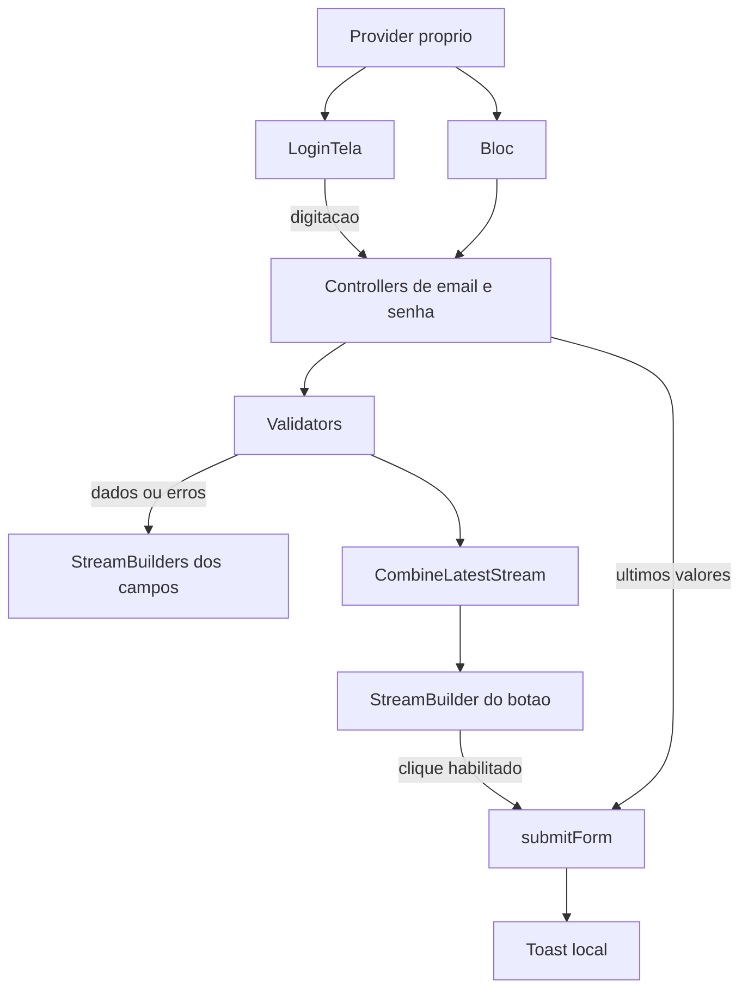
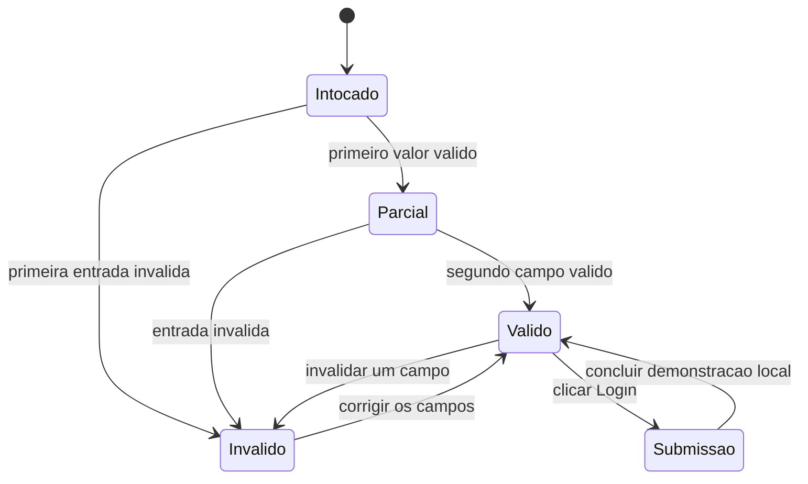

# Apostila 02 - Gerenciamento de estado - Plan

## Goal Capsule

- **Objetivo:** permitir estudar e executar o formulário de login da apostila 02, acompanhando cada evolução pelo histórico de commits.
- **Meio:** BLoC manual, streams, Provider próprio, RxDart e Toast, conforme KTD1 e KTD2.
- **Autoridade:** pedido do usuário e decisões da conversa; PDF como especificação didática; documentação oficial para compatibilidade com o SDK instalado.
- **Entrega:** um aplicativo separado, uma branch e um PR, com commits por etapa na ordem do material. Execução sequencial.
- **Limite desta rodada:** apenas planejamento; implementação, criação de branch, commits e publicação dependem do início da execução.
- **Encerramento da futura execução:** entregar o PR no GitHub para análise e merge pelo usuário, acompanhado dos resultados e limitações reais. Não fazer merge automaticamente.

---

## Product Contract

### Summary

Implementar o restante integral da apostila 02 como um novo aplicativo `gerenciamento_de_estado`, preservando os passos intermediários relevantes em commits. O resultado é um formulário com e-mail e senha, mensagens de validação, habilitação reativa do botão e submissão fictícia com Toast.

### Problem Frame

O repositório contém o aplicativo de fotos da apostila 01, mas ainda não contém o projeto de gerenciamento de estado. A apostila 02 ensina outro aplicativo; misturá-lo ao de fotos perderia a separação das aulas e dificultaria acompanhar sua evolução.

### Requirements

**Organização e fidelidade**

- R1. Criar `ap002_apostila_flutter_gerenciamento_de_estado/`, com pacote `gerenciamento_de_estado`, na branch `apostila-02-gerenciamento-de-estado`, a partir da `main` remota atualizada.
- R2. Seguir a progressão do PDF até a demonstração final das páginas 89–90, mantendo commits por etapa e os exemplos DartPad separados da aplicação.
- R3. Registrar erros deliberados de ensino em exemplos comentados ou documentação; os commits que concluem etapas devem compilar e passar nas verificações correspondentes.

**Formulário e estado**

- R4. Montar a tela `LoginTela` com campos de e-mail e senha, senha oculta e botão `Login` ocupando a largura, respeitando textos e margens do material.
- R5. Validar o formato do e-mail com `email_validator` e a senha com pelo menos quatro caracteres, usando os textos de erro da apostila.
- R6. Implementar a sequência BLoC global, `StreamBuilder`, Provider próprio baseado em `InheritedWidget`, streams broadcast e `BehaviorSubject`, sem substituir o desenho por bibliotecas de estado diferentes.
- R7. No fluxo final, iniciar com campos sem mensagens de erro e botão desabilitado; refletir as validações dos campos e usar a combinação de streams para o estado do botão.
- R8. Submeter de forma fictícia os últimos valores digitados e mostrar o Toast da apostila, usando somente dados inventados de demonstração.

**Verificação e entrega**

- R9. Validar cada etapa, consolidar testes de streams/widgets e conferir o formulário no navegador em tela estreita e larga.
- R10. Documentar diferenças de versão, limitações de plataforma e eventuais defeitos do material; entregar depois um único PR para merge manual pelo usuário.

### Scope Boundaries

Inclui exemplos de getters/setters e covariância, validação de campos, gerenciamento de estado e submissão local fictícia.

Não inclui servidor de autenticação, cadastro, persistência, navegação para outra tela, Firebase, chave da Pexels, regras extras de senha ou instalação de uma biblioteca `provider`/`flutter_bloc`. Esses mecanismos não são solicitados pelo exercício.

Correções dos problemas conhecidos da apostila 01 ficam fora desta entrega. Endurecimento do exemplo de login para uso real e correções de lógica que alterem o fluxo didático deverão ser apresentados ao usuário após o diagnóstico, em vez de introduzidos silenciosamente.

### Sources

- PDF fornecido pelo usuário: `C:/Users/jv070/OneDrive/Área de Trabalho/ECM252-Linguagem de Programação 2/4Bimestre/02_apostila_flutter_gerenciamento_de_estado.pdf`, 91 páginas. Páginas 1–4: introdução; 5–90: desenvolvimento e demonstrações; 91: referências.
- Repositório: `JoaoVitorSesma/2026_maua_ecm252_flutter`; [PR 1 da apostila 01](https://github.com/JoaoVitorSesma/2026_maua_ecm252_flutter/pull/1), confirmado como mesclado em 31/10/2026.
- Padrões locais: `README.md`, `ap001_apostila_flutter_app_fotos/README.md`, `ap001_apostila_flutter_app_fotos/test/widget_test.dart` e `ap001_apostila_flutter_app_fotos/exemplos_dartpad/`.
- [CombineLatestStream](https://pub.dev/documentation/rxdart/latest/rx/CombineLatestStream-class.html), [BehaviorSubject](https://pub.dev/documentation/rxdart/latest/rx/BehaviorSubject-class.html), [email_validator](https://pub.dev/packages/email_validator) e [fluttertoast](https://pub.dev/packages/fluttertoast), consultados em 31/10/2026.

---

## Planning Contract

### Current State

O PR 1 já foi mesclado no GitHub. O checkout local permanece em `apostila-01-app-fotos`, no commit `2412ad5`, e estava limpo antes da escrita deste plano. A execução deverá atualizar a referência da `main` e partir dela, sem acrescentar novos commits à branch da apostila 01.

O projeto existente usa Dart `^3.13.1`; a validação anterior utilizou Flutter 3.47.1. Não há projeto da apostila 02, configuração Compound Engineering local, loja de aprendizados ou plano anterior correspondente. Nenhuma instalação, compilação ou execução de teste foi feita durante este planejamento.

### Key Technical Decisions

- KTD1. **Projeto separado e nomes didáticos.** Aplicar R1 e R6 mantendo `App`, `LoginTela`, `Bloc`, `Validators` e `Provider`, conforme a apostila. O Provider é uma classe própria, sem dependência no pacote de mesmo nome.
- KTD2. **Evolução preservada por commits.** Aplicar R2 e R3 mantendo a versão global antes da versão com Provider, e broadcast antes de `BehaviorSubject`. Não pular diretamente ao código final. A proposta prevê dez etapas de conteúdo e uma de consolidação.
- KTD3. **Compatibilidade mínima e explícita.** Manter as APIs ensinadas e registrar qualquer ajuste necessário ao SDK. Para `email_validator`, começar pela faixa `^2.1.16` citada na página 30, se o resolvedor a aceitar. RxDart e fluttertoast não têm versão fixada no trecho de instalação do PDF: selecionar versões compatíveis e versionar o lockfile. As referências consultadas expõem RxDart 0.28.0, email_validator 3.0.0 e fluttertoast 10.0.2; são referências de pesquisa, não promessa de resolução local.
- KTD4. **Diagnóstico antes de correção de desvios do material.** Registrar hipóteses como não confirmadas até reproduzi-las. Correções que apenas completem o código indicado nas páginas seguintes pertencem à etapa; mudanças adicionais de comportamento devem constar do relatório final. Isso aplica R3 e R10.
- KTD5. **Toast fiel, com validação por plataforma.** Usar `Fluttertoast.showToast` como na página 89, preservando parâmetros quando suportados. A documentação atual informa suporte Web, mas limita o posicionamento vertical a topo/baixo; Android 11+ também pode ignorar personalizações. Não substituir por `SnackBar` nem declarar equivalência visual sem verificar.
- KTD6. **Dados fictícios e envio local.** Aplicar R8 sem servidor nem credenciais reais. O print intermediário e o Toast que incluem senha são demonstrações do PDF, não uma implementação de autenticação pronta para uso real.
- KTD7. **Publicação com merge manual.** Aplicar R10 enviando a futura branch ao mesmo remoto e abrindo PR para `main`. (session-settled: user-directed — chosen over merge automático: o usuário quer analisar o PR e aplicar o merge pelo GitHub.) Este planejamento não executa a publicação.

### High-Level Technical Design

O Provider envolve o aplicativo e fornece o Bloc ao contexto da tela. A digitação entra nos controllers, os validadores produzem dados ou erros e os StreamBuilders atualizam os campos. A combinação dos streams alimenta o botão; a submissão usa os valores dos subjects e aciona o Toast.



Estados a conferir: formulário intocado; apenas um campo válido; campo inválido; ambos válidos; envio fictício. O fluxo válido → inválido → edição do outro campo precisa de diagnóstico específico, pois pode divergir da intenção de R7 na implementação literal.



Esse diagrama expressa a intenção do formulário. O diagnóstico de U8 verifica se a transcrição literal respeita todas as transições; uma divergência deve aparecer no relatório, conforme KTD4.

### Output Structure

```text
ap002_apostila_flutter_gerenciamento_de_estado/
  lib/main.dart
  lib/src/app.dart
  lib/src/telas/login_tela.dart
  lib/src/blocs/bloc.dart
  lib/src/blocs/validators.dart
  lib/src/blocs/provider.dart
  exemplos_dartpad/getters_setters.dart
  exemplos_dartpad/covariancia.dart
  test/widget_test.dart
  test/bloc_test.dart
  test/validators_test.dart
  test/provider_test.dart
  test/submit_form_test.dart
  pubspec.yaml
  pubspec.lock
  README.md
```

Os arquivos gerados de plataforma permanecem dentro do novo aplicativo, como na apostila 01. Os caminhos abaixo são relativos à raiz do repositório.

---

## Implementation Units

| Unidade | Resultado | Arquivos principais | Dependência |
| --- | --- | --- | --- |
| U1 | Aplicativo inicial | novo projeto, main, app | main remota atualizada |
| U2 | Formulário visual | login_tela, widget_test | U1 |
| U3 | Streams e getters | bloc, exemplos, bloc_test | U2 |
| U4 | Validadores e dispose | validators, bloc, testes | U3 |
| U5 | Validação com Bloc global | login_tela, bloc, widget_test | U4 |
| U6 | Provider e covariância | provider, exemplos, provider_test | U5 |
| U7 | Bloc obtido pelo contexto | app, login_tela, provider_test | U6 |
| U8 | Botão reativo e broadcast | bloc, login_tela, testes | U7 |
| U9 | Últimos valores e submissão | bloc, submit_form_test | U8 |
| U10 | Toast | bloc, dependências, testes | U9 |
| U11 | Verificação e documentação | READMEs, testes necessários, plano | U10 |

### U1. Criar a base do aplicativo

- **Páginas:** 5–10. **Cobre:** R1–R3. **Dependência:** `main` remota atualizada e PR 1 já integrado.
- **Arquivos:** `ap002_apostila_flutter_gerenciamento_de_estado/` gerado pelo Flutter, com `lib/main.dart`, `lib/src/app.dart`, `pubspec.yaml`, `pubspec.lock` e `test/widget_test.dart`.
- **Abordagem:** preparar a branch R1; gerar o pacote com o nome indicado; substituir o contador de exemplo por `App` sem estado e a estrutura inicial da apostila. Transportar este plano sem misturá-lo à branch anterior.
- **Verificação:** aplicação inicial abre com o texto de teste do material; teste gerado do contador é substituído por uma verificação da tela real. Scaffolding de plataforma exige análise e abertura, sem testes que apenas enumerem arquivos.
- **Commit previsto:** `feat(aula02-flutter): crie a base do aplicativo de gerenciamento de estado`.

### U2. Construir o formulario

- **Páginas:** 11–20. **Cobre:** R4. **Dependência:** U1.
- **Arquivos:** `ap002_apostila_flutter_gerenciamento_de_estado/lib/src/app.dart`, `ap002_apostila_flutter_gerenciamento_de_estado/lib/src/telas/login_tela.dart` e `ap002_apostila_flutter_gerenciamento_de_estado/test/widget_test.dart`.
- **Abordagem:** tela sem estado, margem de 20, métodos dos campos e botão; teclado de e-mail, textos da apostila, senha oculta, margem superior de 12 no botão e expansão horizontal por Row/Expanded.
- **Cenários:** ambos os campos e Login aparecem; senha tem obscureText; botão ocupa a largura disponível; não há overflow nas larguras 320 e 1280.
- **Commit previsto:** `feat(aula02-flutter): monte os campos e o botao de login`.

### U3. Introduzir streams e getters

- **Páginas:** 21–29. **Cobre:** R2, R6. **Dependência:** U2.
- **Arquivos:** `ap002_apostila_flutter_gerenciamento_de_estado/lib/src/blocs/bloc.dart`, `ap002_apostila_flutter_gerenciamento_de_estado/exemplos_dartpad/getters_setters.dart` e `ap002_apostila_flutter_gerenciamento_de_estado/test/bloc_test.dart`.
- **Abordagem:** controllers tipados e privados, streams e getters de funções de entrada com os nomes do PDF; exemplo de Pessoa das páginas 26–27 separado da aplicação.
- **Cenários:** um valor de e-mail e um de senha percorrem seus streams; uma nova instância não herda dados de outra; exemplo Pessoa permite ler nome/idade e alterar nome.
- **Commit previsto:** `feat(aula02-flutter): introduza o Bloc com streams e getters`.

### U4. Validar os campos e fechar recursos

- **Páginas:** 30–34. **Cobre:** R5, R6. **Dependência:** U3.
- **Arquivos:** `ap002_apostila_flutter_gerenciamento_de_estado/lib/src/blocs/validators.dart`, `ap002_apostila_flutter_gerenciamento_de_estado/lib/src/blocs/bloc.dart`, `ap002_apostila_flutter_gerenciamento_de_estado/pubspec.yaml`, `ap002_apostila_flutter_gerenciamento_de_estado/pubspec.lock`, `ap002_apostila_flutter_gerenciamento_de_estado/test/validators_test.dart` e `ap002_apostila_flutter_gerenciamento_de_estado/test/bloc_test.dart`.
- **Abordagem:** pacote email_validator, mixin Validators, transformações e método dispose exatamente na progressão do material.
- **Cenários:** `aluno@example.com` atravessa o validador; `aluno` produz “E-mail inválido”; senha `123` produz “Senha deve ter, pelo menos, 4 caracteres”; `1234` passa; dispose encerra os dois streams com assinaturas devidamente encerradas no teste.
- **Commit previsto:** `feat(aula02-flutter): valide email e senha nos streams do Bloc`.

### U5. Conectar o Bloc global aos campos

- **Páginas:** 35–48. **Cobre:** R5–R7. **Dependência:** U4.
- **Arquivos:** `ap002_apostila_flutter_gerenciamento_de_estado/lib/src/blocs/bloc.dart`, `ap002_apostila_flutter_gerenciamento_de_estado/lib/src/telas/login_tela.dart` e `ap002_apostila_flutter_gerenciamento_de_estado/test/widget_test.dart`.
- **Abordagem:** instância global provisória, StreamBuilder tipado por campo, onChanged e errorText condicional. A reprodução intermediária de “null” fica documentada; a correção da página 45 faz parte desta etapa.
- **Cenários:** nenhuma mensagem aparece ao abrir; digitar e-mail inválido mostra o erro; corrigi-lo remove a mensagem; senha com um a três caracteres mostra o erro; quatro caracteres removem-no.
- **Commit previsto:** `feat(aula02-flutter): conecte os campos ao Bloc global`.

### U6. Criar o Provider proprio e o exemplo de covariancia

- **Páginas:** 49–62. **Cobre:** R2, R6. **Dependência:** U5.
- **Arquivos:** `ap002_apostila_flutter_gerenciamento_de_estado/lib/src/blocs/provider.dart`, `ap002_apostila_flutter_gerenciamento_de_estado/exemplos_dartpad/covariancia.dart` e `ap002_apostila_flutter_gerenciamento_de_estado/test/provider_test.dart`.
- **Abordagem:** InheritedWidget, construtor com child/key, Bloc próprio, updateShouldNotify e Provider.of. Concluir o exemplo Animal/Cachorro/Papagaio/Gato com covariant; deixar chamadas inválidas comentadas e explicadas.
- **Cenários:** descendente recupera o Bloc do Provider ancestral; dois Providers fornecem instâncias distintas; exemplo válido executa e demonstra as amizades permitidas.
- **Commit previsto:** `feat(aula02-flutter): forneca o Bloc por um Provider proprio`.

### U7. Substituir o Bloc global pelo contexto

- **Páginas:** 63–66. **Cobre:** R6. **Dependência:** U6.
- **Arquivos:** `ap002_apostila_flutter_gerenciamento_de_estado/lib/src/app.dart`, `ap002_apostila_flutter_gerenciamento_de_estado/lib/src/telas/login_tela.dart`, `ap002_apostila_flutter_gerenciamento_de_estado/lib/src/blocs/bloc.dart`, `ap002_apostila_flutter_gerenciamento_de_estado/test/provider_test.dart` e `ap002_apostila_flutter_gerenciamento_de_estado/test/widget_test.dart`.
- **Abordagem:** envolver MaterialApp com Provider; obter o Bloc no build e repassá-lo aos métodos dos campos/botão; remover a instância global do código final, preservando-a no commit U5.
- **Cenários:** validação da tela continua funcionando; duas árvores com Providers próprios não compartilham dados; LoginTela sempre está abaixo do Provider.
- **Commit previsto:** `refactor(aula02-flutter): substitua o Bloc global pelo Provider`.

### U8. Combinar streams e controlar o botao

- **Páginas:** 67–81. **Cobre:** R6, R7. **Dependência:** U7.
- **Arquivos:** `ap002_apostila_flutter_gerenciamento_de_estado/lib/src/blocs/bloc.dart`, `ap002_apostila_flutter_gerenciamento_de_estado/lib/src/telas/login_tela.dart`, `ap002_apostila_flutter_gerenciamento_de_estado/pubspec.yaml`, `ap002_apostila_flutter_gerenciamento_de_estado/pubspec.lock`, `ap002_apostila_flutter_gerenciamento_de_estado/test/bloc_test.dart` e `ap002_apostila_flutter_gerenciamento_de_estado/test/widget_test.dart`.
- **Abordagem:** RxDart, CombineLatestStream.combine2 e emailPasswordAreOk; concluir com controllers broadcast e botão condicionado por hasData. Explicar as tentativas com assinatura única e hasError que o próprio material corrige; não criar um commit final desta etapa com essas falhas transitórias.
- **Cenários:** botão começa desabilitado; apenas um campo válido não habilita; ambos válidos habilitam; introduzir erro desabilita; múltiplos consumidores não geram “Stream has already been listened to”. Diagnosticar também válido → inválido em um campo → nova edição válida no outro campo, sem antecipar o resultado.
- **Commit previsto:** `feat(aula02-flutter): controle o botao combinando streams com RxDart`.

### U9. Recuperar valores e simular submissao

- **Páginas:** 81–85. **Cobre:** R6, R8. **Dependência:** U8.
- **Arquivos:** `ap002_apostila_flutter_gerenciamento_de_estado/lib/src/blocs/bloc.dart`, `ap002_apostila_flutter_gerenciamento_de_estado/lib/src/telas/login_tela.dart`, `ap002_apostila_flutter_gerenciamento_de_estado/test/bloc_test.dart` e `ap002_apostila_flutter_gerenciamento_de_estado/test/submit_form_test.dart`.
- **Abordagem:** trocar controllers por BehaviorSubject, sem broadcast explícito nem valores iniciais semeados; implementar submitForm lendo os últimos valores e ligá-lo ao botão. Preservar a versão de impressão local deste passo no histórico.
- **Cenários:** dois consumidores recebem os valores recentes; editar após um par válido faz a submissão usar o último par digitado; formulário vazio não permite disparo pelo botão; subscriptions e subjects são encerrados nos testes.
- **Commit previsto:** `feat(aula02-flutter): use BehaviorSubject na submissao ficticia`.

### U10. Exibir o Toast de demonstracao

- **Páginas:** 85–90. **Cobre:** R8–R10. **Dependência:** U9.
- **Arquivos:** `ap002_apostila_flutter_gerenciamento_de_estado/lib/src/blocs/bloc.dart`, `ap002_apostila_flutter_gerenciamento_de_estado/pubspec.yaml`, `ap002_apostila_flutter_gerenciamento_de_estado/pubspec.lock`, `ap002_apostila_flutter_gerenciamento_de_estado/test/submit_form_test.dart` e `ap002_apostila_flutter_gerenciamento_de_estado/README.md`.
- **Abordagem:** fluttertoast e parâmetros da página 89, conforme KTD5; trocar o print pela chamada do exemplo. A simulação do canal do plugin em testes não exige criar uma camada nova em produção.
- **Cenários:** com dados fictícios válidos, clique invoca o Toast com os últimos valores; verificar duração curta, cores e fonte pretendidas. Conferir aparência e duração em plataforma disponível; separar observação real de chamada simulada.
- **Verificação condicional:** sem dispositivo/emulador acessível, registrar “Toast nativo não verificado” e testar a Web quando suportada, sem afirmar equivalência com o posicionamento central do exemplo nativo.
- **Commit previsto:** `feat(aula02-flutter): exiba o Toast na submissao do formulario`.

### U11. Consolidar verificacao e documentacao

- **Páginas:** revisão integral de 1–90; 91 contém as referências. **Cobre:** R2, R3, R9, R10. **Dependência:** U10.
- **Arquivos:** `README.md`, `ap002_apostila_flutter_gerenciamento_de_estado/README.md`, testes já previstos quando houver lacunas relevantes e este plano, caso ainda não esteja versionado.
- **Abordagem:** mapear páginas para commits efetivamente criados, registrar versões, instruções de execução, ajustes mínimos e problemas reproduzidos. Conferir a aplicação da apostila 01 sem modificá-la. Publicar a futura branch e abrir o PR conforme KTD7 somente ao concluir a implementação.
- **Verificação:** cumprir o contrato abaixo e entregar os resultados com suas limitações, sem transformar defeitos diagnosticados do material em testes verdes que finjam comportamento correto.
- **Commits previstos:** um commit de testes finais se houver mudança de cobertura, seguido de `docs(aula02-flutter): registre as etapas e limitacoes da apostila`.

---

## Verification Contract

Os comandos da nova aplicação serão executados dentro de `ap002_apostila_flutter_gerenciamento_de_estado/`, após resolver suas dependências.

| Conferência | Critério |
| --- | --- |
| `flutter analyze --no-fatal-infos` | Sem erros ou warnings; sugestões informativas didáticas são identificadas. |
| `flutter test` | Validators, Bloc, Provider, widgets e submissão cobertos conforme U4–U10. |
| `flutter build web` | Compilação Web concluída ou falha real identificada com sua causa. |
| Exemplos DartPad | Getters/setters e covariância válidos executam; tentativas inválidas estão comentadas. |
| Navegador em 320 e 1280 pixels | Digitação, mensagens, botão, submissão, largura e console conferidos. |
| Toast | Registrar plataforma, versão, evidência visual real e limites; mock não comprova aparência nativa. |
| Regressão da apostila 01 | Rodar sua suíte existente ao final; nenhum ajuste de produção no aplicativo de fotos pertence a este plano. |
| Histórico e publicação | Commits por etapa, branch correta e PR para main com resultados e limitações; merge reservado ao usuário. |

Os erros transitórios que o próprio PDF corrige devem desaparecer até a etapa correspondente. Diagnósticos de defeitos residuais ficam claramente separados dos testes de comportamento desejado. Se revelarem uma divergência real entre a intenção de R7 e a transcrição literal, apresentar o caso e sua consequência; o usuário escolheu revisar problemas ao final, portanto não ocultá-los nem alterar a arquitetura para forçar a aprovação dos testes.

---

## Deferred / Open Questions

Não há decisão de produto pendente para iniciar a implementação após a aprovação deste plano. Os itens abaixo exigem verificação durante a execução.

- **Resolução dos pacotes:** verificar compatibilidade efetiva com o SDK instalado, mantendo KTD3 e registrando as versões resolvidas. Não atualizar dependências da apostila 01 por conveniência.
- **Transcrição:** o documento alterna `pubspec.yml` e `pubspec.yaml`; usar o nome real `pubspec.yaml` gerado pelo Flutter, anotando a diferença no README.
- **Toast real:** verificar se existe dispositivo/emulador utilizável e qual comportamento a versão escolhida apresenta na Web. Não instalar/configurar um ambiente móvel inteiro apenas para encobrir essa ausência.
- **Combinação após erros:** investigar a sequência especificada em U8. A documentação descreve a combinação de últimos dados, mas o efeito exato com addError, StreamBuilder e as versões escolhidas ainda não foi executado.
- **Ciclo de vida:** a apostila ensina Bloc.dispose, mas o Provider mostrado não define por si só o descarte do Bloc quando sai da árvore. Registrar a limitação se confirmada, preservando o exemplo; os testes devem fechar seus próprios recursos.
- **Reconstruções e inscrições:** observar se getters que produzem streams transformados em cada acesso causam reinscrições, perda aparente de eventos ou resets no ambiente atual. São hipóteses de diagnóstico, não bugs já comprovados.

---

## Definition of Done

- Todos os exemplos, exercícios e evoluções de U1–U10 estão representados no código final ou no histórico/documentação quando transitórios.
- O pacote e a branch seguem R1; os arquivos da apostila 01 permanecem com o comportamento anterior.
- Cada etapa concluída tem commit próprio e evidência de verificação correspondente.
- A versão final usa Provider próprio, BehaviorSubject, validadores, combinação de streams e Toast local.
- A documentação distingue verificações concluídas, limitações confirmadas e hipóteses não executadas.
- Os resultados de testes, análise, build, navegador e plataforma do Toast estão informados sem alegar validação além da realizada.
- Ao executar a entrega autorizada, o PR publicado permite ao usuário revisar todos os commits e realizar o merge no GitHub.
